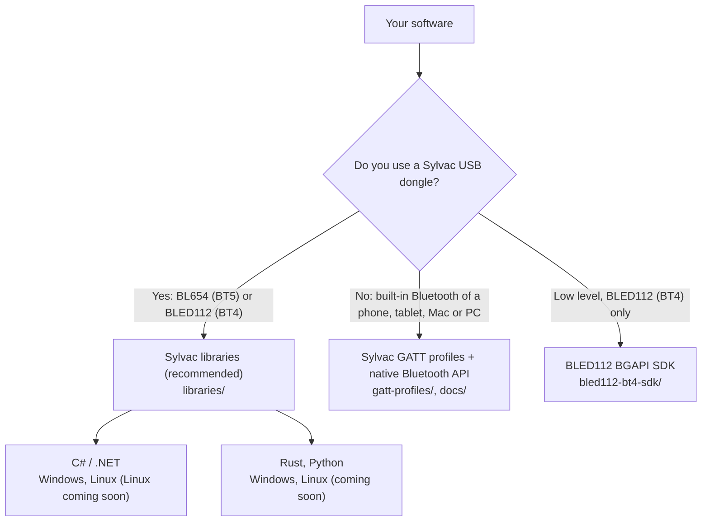

# Sylvac Bluetooth Developer Tools

Everything you need to connect Sylvac Bluetooth® instruments (calipers, indicators, micrometers, height gauges and more) to your own software.

With these tools your application can:

- discover Sylvac instruments around it and connect one or many of them,
- read the live measured value, the unit and the measuring mode,
- receive the value sent when the operator presses the instrument button,
- send commands to the instrument (for example `ID?`) and read its answer.

## Sylvac USB dongles

Sylvac sells two USB dongles. Both are supported by the Sylvac libraries, so the same software works with either of them.

| Dongle | Bluetooth | Inside | Sylvac ref. | Instruments at the same time |
|---|---|---|---|---|
| Bluetooth 5 SMART dongle | **Bluetooth 5** (BT5) | BL654 module (Ezurio, formerly Laird Connectivity) | 981-7102, 981-7103 (external antenna) | up to 16, long range mode |
| Bluetooth 4 dongle | **Bluetooth 4.0** (BT4) | BLED112 (Silicon Labs Bluegiga) | 981-7100 | up to 8 |

Both dongles appear as a virtual serial port: `COMx` on Windows, `/dev/ttyACMx` on Linux. More information on the [dongle product page](https://www.sylvac.ch/product/dongle-smart/).

## Choose your path



| You want to... | Use | Dongles | Platforms |
|---|---|---|---|
| **Connect instruments through a Sylvac dongle (recommended)** | [Sylvac libraries](libraries) | BL654 (BT5) and BLED112 (BT4) | C# / .NET: Windows, Linux (Linux coming soon). Rust and Python: Windows, Linux (coming soon) |
| Use the built-in Bluetooth of a phone, tablet, Mac or PC, without dongle | [Sylvac GATT profiles](gatt-profiles) and the [list of native APIs and libraries](docs/MAN-DeveloperResources_OS.pdf) | none | Android, iOS, macOS, Linux, Windows |
| Program the BLED112 (BT4) dongle at low level with the Bluegiga BGAPI protocol | [BLED112 BGAPI SDK](bled112-bt4-sdk) | BLED112 (BT4) only | Windows |
| Maintain an existing integration based on the C++ communication DLL | [C++ communication DLL](legacy/cpp-dll) (legacy, 2019) | BLED112 (BT4), or built-in Bluetooth on Windows 10 | Windows |

The libraries hide all the Bluetooth details: you get instruments, values and commands, and the same code runs with the BT5 and the BT4 dongle. Low-level BGAPI programming is only useful in special cases and only covers the BLED112 (BT4).

## Quick start in C#

A complete WPF example is available in [libraries/csharp](libraries/csharp), together with a [ready-to-run build](libraries/csharp/BluetoothExample.zip). The essentials look like this:

```cs
using SylvacBleLib;

var ble = BleManager.Instance;
ble.Start();

// Dongles plugged in the computer
ble.BleCentrals.ListChanged += (s, e) => { /* e.AddedItems, e.RemovedItems */ };

// Scan for Sylvac instruments only
ble.BleScanManager.SylvacOnly = true;
ble.BleScanManager.Advertisers.ListChanged += (s, e) => { /* found instruments */ };
ble.BleScanManager.StartScan();

// Connect an instrument found by the scan
dongle.StartConnect(advItem.Mac, out BlePeripheral instrument);

// Live values, button presses and commands
instrument.NumericalValueChanged += (s, e) => { /* instrument.NumericalValue */ };
instrument.InstrumentButtonPressed += (s, e) => { /* e.Value */ };
instrument.InstrumentResponseReceived += (s, e) => { /* e.Value */ };
instrument.SendCommand("ID?");
```

The [library guide](libraries/csharp/README.md) explains installation, threading and every step in detail. SylvacBleLib is still in beta and its API may change.

## How Sylvac instruments talk Bluetooth

You only need this if you program the Bluetooth link yourself (native API or BGAPI). The libraries do it for you.

- Sylvac instruments advertise a device name starting with `SY`. OEM compatible instruments use `MTY`.
- The measured value is provided by the **Simple Data Service (SDS)**.
- Commands and answers go through the **Sylvac Metrology Service (SMS)**, service `0x5000`: write the command on RemoteRequest `0x5012`, receive the answer on RemoteResponse `0x5013` (notify). DataSend `0x5010` (indicate) carries the value sent with the instrument button.
- Sylvac base UUID: `C1B2xxxx-CAAF-6D0E-4C33-7DAE30052840`.
- SMS strings are plain ASCII terminated by a carriage return (`0x0D`), sent in chunks of 20 bytes at most.
- The instrument can be configured in SIMPLE (no pairing), PAIR or HID (keyboard) profile.

Start with [the README of the GATT profiles folder](gatt-profiles/README.txt), which gives the reading order of the specifications.

## Repository content

```
libraries/           Sylvac libraries, for BL654 (BT5) and BLED112 (BT4) dongles
  csharp/            SylvacBleLib (.NET) and the BluetoothExample WPF application
  rust/              Rust library with its Python interface (coming soon)
gatt-profiles/       Bluetooth profile, SDS and SMS specifications (PDF)
docs/                Native Bluetooth APIs and libraries for other platforms
bled112-bt4-sdk/     Bluegiga BGAPI SDK and tools, BLED112 (BT4) dongle only
legacy/cpp-dll/      C++ communication DLL v1.45, headers and HTML API reference
```

## Support

Sylvac supports its libraries, the C++ communication DLL, the dongles and the GATT profiles. Native development on other platforms is not supported by Sylvac, but the specifications in this repository contain everything needed. To get in touch, go to [sylvac.ch](https://www.sylvac.ch/data-transmission-software/).

## License

See [LICENSE](LICENSE). Third-party components keep their own license.
